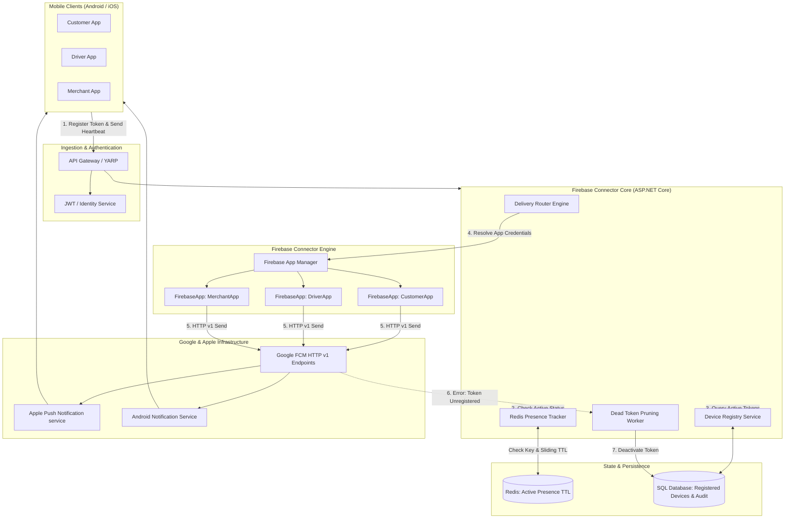
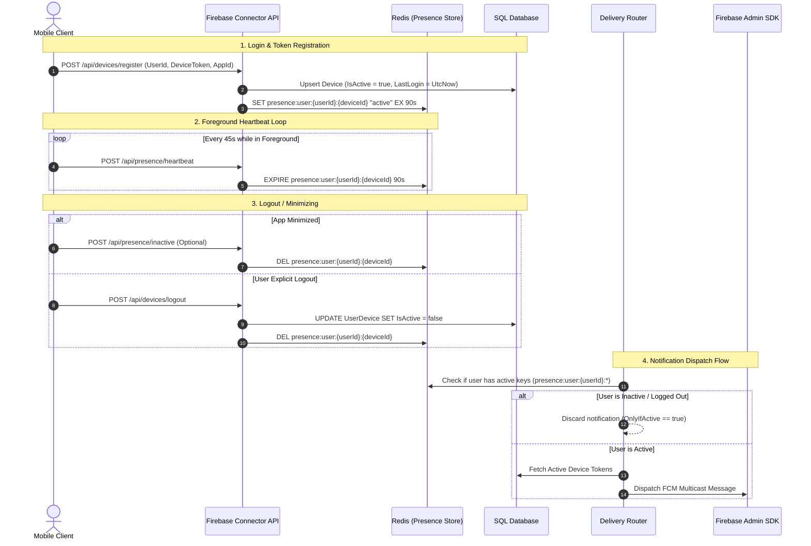

# Firebase Connector: Real-Time Notification Architecture & Implementation Blueprint

## 1. Executive Summary & Purpose

The **Firebase Connector** is a high-throughput, resilient push notification gateway built on **ASP.NET Core (.NET 8/9)**. It acts as an enterprise notification dispatcher integrating with Google's **Firebase Cloud Messaging (FCM)** via the **Firebase Admin SDK**.

### Core Objectives
1. **Real-Time Notification Delivery:** Deliver low-latency push notifications to mobile devices (Android & iOS).
2. **Active & Logged-In User Filtering:** Target *only* users who are currently logged in and actively using the application, avoiding notification spam to inactive or signed-out devices.
3. **Multi-App & Multi-Project Routing:** Flexibly route messages whether all apps share a single Firebase project or each client app (e.g., Customer, Driver, Merchant) operates under an isolated Firebase project.
4. **Resilient Token Management:** Seamlessly handle token registration, token rotation, and automatic pruning of invalidated/uninstalled tokens.

---

## 2. High-Level System Architecture

### 2.1 Architectural Diagram



---

## 3. Key Design Decisions

### 3.1 Does each mobile app have its own Firebase project? How does the central system route to the desired app?

There are two primary models:

#### Model 1: Multiple Apps inside ONE Firebase Project (Unified Ecosystem)
* **How it works:** A single Firebase project can host multiple apps (e.g., Android Customer, iOS Customer, Android Driver, iOS Driver).
* **Credentials:** All apps share the **same Project ID** and the **same Service Account JSON**.
* **Routing:** Firebase device tokens are cryptographically bound to each app's package name / bundle ID. When your backend dispatches a message using the single Firebase Admin instance, **Google FCM automatically delivers the message to the correct app and OS**.
* **Best suited for:** A single product family or company where all apps share operational and billing boundaries.

#### Model 2: Distinct Firebase Projects per App (Multi-Tenant / Isolated Organizations)
* **How it works:** Each application has its own dedicated Firebase project (e.g., `company-customer-prod`, `company-driver-prod`).
* **Credentials:** Each project has its own separate Service Account JSON private key.
* **How the Central Backend Routes It:**
  The `FirebaseAdmin` SDK for .NET natively supports **Named FirebaseApp Instances**. Rather than using `FirebaseApp.DefaultInstance`, the central system initializes and registers named instances:
  ```csharp
  // Registered at startup
  FirebaseApp.Create(optionsCustomer, "CustomerApp");
  FirebaseApp.Create(optionsDriver, "DriverApp");
  ```
  The **Delivery Router** looks up the target device's `AppId` and fetches the corresponding `FirebaseMessaging` instance:
  ```csharp
  var app = FirebaseApp.GetInstance(device.AppId);
  var messagingClient = FirebaseMessaging.Get(app);
```

### 3.2 Do I Need a Separate Firebase Project for the Core Application / Backend?

> [!IMPORTANT]
> **NO, absolutely not.** Your Core Application / Notification Engine does **NOT** need its own Firebase project.

#### Why?
1. **Firebase Projects Exist for Client Applications:**
   * A Firebase Project is a cloud container designed to host **client applications** (Android APKs, iOS IPAs, Web apps) and issue device push tokens.
   * Your Core Backend is not a mobile device; it never receives FCM pushes. It acts solely as an **authorized sender** calling Google's HTTP v1 APIs.

2. **FCM Tokens are Cryptographically Locked to their Origin Project:**
   * When Mobile App A boots up, Google issues an FCM token linked to **Project A's Project Number / Sender ID**.
   * If you created a separate Firebase project for the Core App (e.g., `CoreSystemProject`) and used its service account to push to App A's token, Google FCM will immediately reject it with:
     ```
     FirebaseMessagingException: SenderId mismatch (HTTP 403)
     or MessagingErrorCode.InvalidArgument / registration-token-not-registered
     ```
   * **Rule of Thumb:** A push notification to a device token generated by Project X can **ONLY** be dispatched using Project X's Service Account Key!

#### The Correct Mental Model:
Think of each mobile app's Firebase Project as an **apartment mailbox**, and your Core Application as the **Postal Delivery Worker**:
* You don't need your own apartment mailbox to deliver mail to tenant A.
* You only need **Tenant A's mailbox key (Tenant A's Service Account JSON)** to drop mail into their box!

```
[Core Notification App] 
     │ (Raises Event: e.g. "OrderPlaced" for App A)
     ▼
[Firebase Connector]
     │ 1. Reads intent -> TargetApp = "AppA"
     │ 2. Selects Service Account Key for Project A
     ▼
[Google FCM HTTP v1] ──(Validates Project A Key)──► [Delivers to App A]
```

---

## 4. Identifying "Active & Currently Logged-In" Mobile Users

### 4.1 The Mobile Lifecycle Challenge
Unlike web browsers, mobile operating systems suspend apps when minimized. A user device can exist in four distinct states:
1. **Foreground / Active:** The user has the app open on screen.
2. **Background / Suspended:** The app is minimized; background tasks are restricted.
3. **Killed / Terminated:** The app process is stopped.
4. **Logged Out:** The user explicitly signed out.

### 4.2 The 3-Pillar Presence Solution



### 4.3 Presence Rules Matrix
| App State | Mobile Client Action | Backend Redis State | Delivery Action |
| :--- | :--- | :--- | :--- |
| **Foreground Active** | Sends heartbeat every 45s | Key exists (TTL ≤ 90s) | Deliver real-time push notification |
| **Background / Suspended** | Heartbeat halted | Key expires after 90s | Skip (if `OnlyIfActive=true`) or deliver standard push |
| **Logged Out** | Calls `/api/devices/logout` | Key deleted; DB `IsActive=false` | **Strictly blocked** |
| **Uninstalled** | None | Key expires; FCM returns `Unregistered` | **Automatically deactivated** in database |

---

## 5. Step-by-Step Firebase Setup

### Step 1: Create Projects in Firebase Console
1. Navigate to the [Firebase Console](https://console.firebase.google.com/).
2. Click **Add project** and name it (e.g., `fcmpoc-connector`).
3. Follow the wizard to complete project creation.

### Step 2: Register Client Mobile Applications
1. In the Project Overview, click **Add app** (Android / iOS):
   - **For Android:**
     - Enter Package Name (e.g., `com.fcmpoc.customerapp`).
     - Provide SHA-1 fingerprint.
     - Download `google-services.json` and place it in the mobile project's `android/app/` folder.
   - **For iOS:**
     - Enter Bundle Identifier (e.g., `com.fcmpoc.customerapp`).
     - Download `GoogleService-Info.plist` and add it to Xcode.
     - In **Project Settings > Cloud Messaging > Apple app configuration**, upload your **APNs Authentication Key (.p8 file)** with Key ID and Team ID.

### Step 3: Generate Service Account Key (Backend)
1. Go to **Project Settings** > **Service accounts** tab.
2. Under **Firebase Admin SDK**, select **.NET**.
3. Click **Generate new private key**, then download the `.json` file.
4. Place this file in a secure location on the server (never commit to git).

---

## 6. Production ASP.NET Core Implementation

### 6.1 Required NuGet Packages
```xml
<ItemGroup>
  <PackageReference Include="FirebaseAdmin" Version="3.1.0" />
  <PackageReference Include="Google.Apis.Auth" Version="1.68.0" />
  <PackageReference Include="StackExchange.Redis" Version="2.8.16" />
  <PackageReference Include="Microsoft.EntityFrameworkCore.SqlServer" Version="8.0.8" />
</ItemGroup>
```

### 6.2 Data Model: Device Registration
```csharp
namespace FCMPOC.Domain.Entities;

public class UserDevice
{
    public Guid Id { get; set; } = Guid.NewGuid();
    public string UserId { get; set; } = default!;
    public string AppId { get; set; } = default!; // e.g. "CustomerApp", "DriverApp"
    public string DeviceToken { get; set; } = default!; // FCM Registration Token
    public string DeviceType { get; set; } = default!; // "Android", "iOS"
    public bool IsActive { get; set; } = true;
    public DateTime CreatedAt { get; set; } = DateTime.UtcNow;
    public DateTime LastLoginAt { get; set; } = DateTime.UtcNow;
    public DateTime? RevokedAt { get; set; }
}
```

### 6.3 Multi-Tenant Firebase App Manager
```csharp
using System.Collections.Concurrent;
using FirebaseAdmin;
using FirebaseAdmin.Messaging;
using Google.Apis.Auth.OAuth2;

namespace FCMPOC.Infrastructure.Firebase;

public interface IFirebaseAppManager
{
    FirebaseMessaging GetMessagingClient(string appId);
}

public class FirebaseAppManager : IFirebaseAppManager
{
    private readonly ConcurrentDictionary<string, FirebaseApp> _apps = new();

    public FirebaseAppManager(IConfiguration configuration)
    {
        InitializeFirebaseApps(configuration);
    }

    private void InitializeFirebaseApps(IConfiguration configuration)
    {
        var projectsSection = configuration.GetSection("FirebaseProjects");
        foreach (var project in projectsSection.GetChildren())
        {
            var appId = project.Key;
            var credentialsPath = project["CredentialsPath"];

            if (!string.IsNullOrEmpty(credentialsPath) && File.Exists(credentialsPath))
            {
                var app = FirebaseApp.Create(new AppOptions
                {
                    Credential = GoogleCredential.FromFile(credentialsPath)
                }, appId);

                _apps.TryAdd(appId, app);
            }
        }
    }

    public FirebaseMessaging GetMessagingClient(string appId)
    {
        if (_apps.TryGetValue(appId, out var app))
        {
            return FirebaseMessaging.Get(app);
        }

        // Fallback to default instance if configured as single project
        if (FirebaseApp.DefaultInstance != null)
        {
            return FirebaseMessaging.DefaultInstance;
        }

        throw new KeyNotFoundException($"No Firebase project initialized for AppId '{appId}'.");
    }
}
```

### 6.4 Redis Sliding Presence Tracker
```csharp
using StackExchange.Redis;

namespace FCMPOC.Infrastructure.Presence;

public interface IPresenceTracker
{
    Task RecordHeartbeatAsync(string userId, string deviceId, TimeSpan ttl);
    Task ClearPresenceAsync(string userId, string deviceId);
    Task<bool> IsUserActiveAsync(string userId);
}

public class RedisPresenceTracker : IPresenceTracker
{
    private readonly IDatabase _redis;

    public RedisPresenceTracker(IConnectionMultiplexer redis)
    {
        _redis = redis.GetDatabase();
    }

    public async Task RecordHeartbeatAsync(string userId, string deviceId, TimeSpan ttl)
    {
        var deviceKey = $"presence:user:{userId}:device:{deviceId}";
        var userSetKey = $"presence:user:{userId}:devices";

        await _redis.StringSetAsync(deviceKey, "active", ttl);
        await _redis.SetAddAsync(userSetKey, deviceId);
        await _redis.KeyExpireAsync(userSetKey, TimeSpan.FromMinutes(10));
    }

    public async Task ClearPresenceAsync(string userId, string deviceId)
    {
        var deviceKey = $"presence:user:{userId}:device:{deviceId}";
        var userSetKey = $"presence:user:{userId}:devices";

        await _redis.KeyDeleteAsync(deviceKey);
        await _redis.SetRemoveAsync(userSetKey, deviceId);
    }

    public async Task<bool> IsUserActiveAsync(string userId)
    {
        var userSetKey = $"presence:user:{userId}:devices";
        var deviceIds = await _redis.SetMembersAsync(userSetKey);

        if (deviceIds.Length == 0) return false;

        foreach (var deviceId in deviceIds)
        {
            var deviceKey = $"presence:user:{userId}:device:{deviceId}";
            if (await _redis.KeyExistsAsync(deviceKey))
            {
                return true;
            }
        }

        return false;
    }
}
```

### 6.5 The Delivery Router Engine
```csharp
using FirebaseAdmin.Messaging;
using FCMPOC.Domain.Entities;

namespace FCMPOC.Core.Routing;

public class NotificationRequest
{
    public string UserId { get; set; } = default!;
    public string Title { get; set; } = default!;
    public string Body { get; set; } = default!;
    public Dictionary<string, string> Data { get; set; } = new();
    public bool OnlyIfActive { get; set; } = true;
}

public class DeliveryResult
{
    public bool Success { get; set; }
    public string? Reason { get; set; }
    public int DeliveredCount { get; set; }
    public int FailedCount { get; set; }
}

public class NotificationDeliveryRouter
{
    private readonly IPresenceTracker _presenceTracker;
    private readonly IDeviceRepository _deviceRepo;
    private readonly IFirebaseAppManager _firebaseAppManager;
    private readonly ILogger<NotificationDeliveryRouter> _logger;

    public NotificationDeliveryRouter(
        IPresenceTracker presenceTracker,
        IDeviceRepository deviceRepo,
        IFirebaseAppManager firebaseAppManager,
        ILogger<NotificationDeliveryRouter> logger)
    {
        _presenceTracker = presenceTracker;
        _deviceRepo = deviceRepo;
        _firebaseAppManager = firebaseAppManager;
        _logger = logger;
    }

    public async Task<DeliveryResult> DispatchAsync(NotificationRequest request)
    {
        // 1. Verify Active User Condition
        if (request.OnlyIfActive)
        {
            var isActive = await _presenceTracker.IsUserActiveAsync(request.UserId);
            if (!isActive)
            {
                _logger.LogInformation("Notification skipped: User {UserId} is inactive or logged out.", request.UserId);
                return new DeliveryResult { Success = false, Reason = "UserInactive" };
            }
        }

        // 2. Fetch Active Registered Devices
        var devices = await _deviceRepo.GetActiveDevicesByUserIdAsync(request.UserId);
        if (!devices.Any())
        {
            return new DeliveryResult { Success = false, Reason = "NoActiveDevicesFound" };
        }

        int delivered = 0;
        int failed = 0;

        // 3. Group by AppId for Multi-Project Delivery
        foreach (var appGroup in devices.GroupBy(d => d.AppId))
        {
            var appId = appGroup.Key;
            var messagingClient = _firebaseAppManager.GetMessagingClient(appId);
            var tokens = appGroup.Select(d => d.DeviceToken).Distinct().ToList();

            var message = new MulticastMessage
            {
                Tokens = tokens,
                Notification = new Notification
                {
                    Title = request.Title,
                    Body = request.Body
                },
                Data = request.Data,
                Android = new AndroidConfig
                {
                    Priority = Priority.High,
                    Notification = new AndroidNotification
                    {
                        ChannelId = "realtime_channel",
                        Sound = "default"
                    }
                },
                Apns = new ApnsConfig
                {
                    Aps = new Aps
                    {
                        Sound = "default",
                        Badge = 1
                    }
                }
            };

            var response = await messagingClient.SendEachForMulticastAsync(message);

            // 4. Handle Dead / Unregistered Tokens
            for (int i = 0; i < response.Responses.Count; i++)
            {
                var sendResp = response.Responses[i];
                if (sendResp.IsSuccess)
                {
                    delivered++;
                }
                else
                {
                    failed++;
                    if (sendResp.Exception.MessagingErrorCode == MessagingErrorCode.Unregistered)
                    {
                        _logger.LogWarning("FCM token {Token} is unregistered. Deactivating in database.", tokens[i]);
                        await _deviceRepo.DeactivateTokenAsync(tokens[i]);
                    }
                }
            }
        }

        return new DeliveryResult { Success = delivered > 0, DeliveredCount = delivered, FailedCount = failed };
    }
}
```

### 6.6 Controllers for Client & Dispatch
```csharp
[ApiController]
[Route("api/[controller]")]
public class NotificationsController : ControllerBase
{
    private readonly NotificationDeliveryRouter _router;

    public NotificationsController(NotificationDeliveryRouter router)
    {
        _router = router;
    }

    [HttpPost("send")]
    public async Task<IActionResult> SendNotification([FromBody] NotificationRequest request)
    {
        var result = await _router.DispatchAsync(request);
        return Ok(result);
    }
}

[ApiController]
[Route("api/[controller]")]
public class PresenceController : ControllerBase
{
    private readonly IPresenceTracker _presenceTracker;

    public PresenceController(IPresenceTracker presenceTracker)
    {
        _presenceTracker = presenceTracker;
    }

    [HttpPost("heartbeat")]
    public async Task<IActionResult> Heartbeat([FromBody] HeartbeatRequest request)
    {
        // Extend presence by 90 seconds
        await _presenceTracker.RecordHeartbeatAsync(request.UserId, request.DeviceId, TimeSpan.FromSeconds(90));
        return Ok(new { status = "HeartbeatRecorded" });
    }

    [HttpPost("inactive")]
    public async Task<IActionResult> SetInactive([FromBody] HeartbeatRequest request)
    {
        await _presenceTracker.ClearPresenceAsync(request.UserId, request.DeviceId);
        return Ok(new { status = "PresenceCleared" });
    }
}
```

### 6.7 Configuration via `.env` (Podman / Docker Compose)
The application avoids hardcoding secrets in `appsettings.json` and dynamically reads hierarchical environment variables from `.env`:

```env
# Database & Redis Connections
ConnectionStrings__Redis=redis:6379

# Multi-Tenant Firebase Project Credentials
FirebaseProjects__CustomerApp__ProjectId=fcmpoc-connector
FirebaseProjects__CustomerApp__CredentialsPath=/app/secrets/firebase-key.json

FirebaseProjects__DriverApp__ProjectId=fcmpoc-connector
FirebaseProjects__DriverApp__CredentialsPath=/app/secrets/firebase-key.json
```
*(In ASP.NET Core, the double underscore `__` automatically maps environment variables to nested configuration sections).*

---

## 7. Recommended Production Enhancements

1. **Decoupled Messaging Queue:** Ingest notification requests through **RabbitMQ** or **Azure Service Bus** to handle bursts without blocking API requests.
2. **Multicast Limits:** Google FCM restricts multicast batches to **500 tokens per call**. The router partitions lists larger than 500 into chunked batches.
3. **Dual-Channel In-App Toasting:** If a user is active in the app, consider combining FCM with **SignalR** so active users get an immediate UI popup without touching the OS tray.

---

## 8. Docker & Kubernetes (AWS EKS) Secret Management

When running the Firebase Connector in Docker on an AWS EKS cluster, **never bake Service Account JSON files into the Docker image**. Choose one of the following 3 production patterns:

### Method 1: In-Memory JSON String via Environment Variable (Simplest - Zero Files)
The Firebase Admin SDK can parse JSON credentials directly from memory via `GoogleCredential.FromJson(jsonString)`:

```csharp
// Load from Environment Variable in C#
var customerJson = Environment.GetEnvironmentVariable("FIREBASE_CUSTOMER_JSON");
var app = FirebaseApp.Create(new AppOptions
{
    Credential = GoogleCredential.FromJson(customerJson)
}, "CustomerApp");
```

**Kubernetes Deployment (`deployment.yaml`):**
```yaml
apiVersion: apps/v1
kind: Deployment
metadata:
  name: firebase-connector
spec:
  template:
    spec:
      containers:
        - name: api
          image: myrepo/firebase-connector:latest
          env:
            - name: FIREBASE_CUSTOMER_JSON
              valueFrom:
                secretKeyRef:
                  name: firebase-credentials
                  key: CUSTOMER_KEY_JSON
```

### Method 2: Kubernetes Secret Mounted as a File Volume (Standard K8s)
Store the JSON files in a Kubernetes Secret and mount them into `/app/secrets/` in your pod:

```bash
kubectl create secret generic fcm-keys \
  --from-file=customer-key.json=./customer-key.json \
  --from-file=driver-key.json=./driver-key.json
```

In your pod spec:
```yaml
volumeMounts:
  - name: fcm-keys-vol
    mountPath: /app/secrets
    readOnly: true
volumes:
  - name: fcm-keys-vol
    secret:
      secretName: fcm-keys
```
In C#: `GoogleCredential.FromFile("/app/secrets/customer-key.json")`.

### Method 3: AWS Secrets Manager + Secrets Store CSI Driver (Enterprise EKS)
* Encrypt credentials inside **AWS Secrets Manager** with AWS KMS.
* Use **IAM Roles for Service Accounts (IRSA)** to grant your pod permission to read the secret.
* The CSI driver automatically syncs and mounts the files into your pod.

---

## 9. End-to-End Testing & Verification Playbook

You do **not** need to set up a heavy Android/iOS emulator or write mobile code to test the Firebase Connector.

### Stage 1: Zero-Dependency Mock Testing (Test Backend Logic Instantly)
You can test the entire backend pipeline (Token Registry, Redis Sliding TTL Presence, Active User Filtering, Logout) without even opening Google Firebase!

1. Start your ASP.NET Core API (`http://localhost:5000`).
2. Run the headless PowerShell test suite:
   ```powershell
   cd "A:\asp.net Projects\FCMPOC\mobile-simulator"
   .\simulate-devices.ps1 -DeviceCount 5 -HeartbeatCycles 3
   ```
3. **What this verifies:**
   * ✅ Device registration (`POST /api/devices/register`) inserts tokens into DB.
   * ✅ Heartbeat loop (`POST /api/presence/heartbeat`) maintains sliding 90s TTL in Redis.
   * ✅ Notification dispatcher filters out inactive/logged-out devices.
   * ✅ Logout (`POST /api/devices/logout`) revokes token in DB and purges Redis presence key.

---

### Stage 2: Real Google FCM Push Test (The 5-Minute "Web Mobile" Setup)
To verify that real notifications travel across Google's actual FCM infrastructure without touching Android Studio:

```
[Firebase Console] ──► Create 1 Project ──► Click [Add Web App] ──► Download Service Account Key
                                                                                │
[C# Backend] ◄──────────────────────────────────────────────────────────────────┘
     │
     │ Dispatches Push Notification
     ▼
[Google FCM] ──► Real Push Notification Pops up on your Windows Desktop!
```

#### The Step-by-Step 5-Minute Walkthrough:
1. **Create 1 Firebase Project:**
   * Go to [Firebase Console](https://console.firebase.google.com/) -> Click **Add project** (e.g. `fcmpoc-test`).
2. **Add a Web App (Takes 30 seconds):**
   * On the project overview page, click the **Web icon (`</>`)**.
   * Give it a nickname (e.g. `TestWebMobile`) -> Click **Register app**.
   * Copy the `firebaseConfig` snippet.
3. **Generate VAPID Key (Web Push Certificate):**
   * Go to **Project settings > Cloud Messaging** tab.
   * Scroll down to **Web configuration** -> Under **Web Push certificates**, click **Generate key pair**.
   * Copy the generated key.
4. **Download the Backend Service Account Key:**
   * Go to **Project settings > Service accounts** tab.
   * Under Firebase Admin SDK, click **Generate new private key** -> Save as `test-service-account.json`.
5. **Configure & Run:**
   * In your backend `appsettings.json`, point `CredentialsPath` to `test-service-account.json`.
   * Open `A:\asp.net Projects\FCMPOC\mobile-simulator\index.html` in Chrome/Edge, paste `firebaseConfig` and `vapidKey`.
   * Click **Login & Register Device** (grant browser notification permission when prompted).
6. **Trigger the Notification:**
   * Send a test request via Swagger / Postman to `POST /api/notifications/send`:
     ```json
     {
       "userId": "driver_alex@company.com",
       "title": "Delivery Alert 🚀",
       "body": "Customer has placed an order!",
       "onlyIfActive": true
     }
     ```
   * **Result:** A real Windows desktop push notification will immediately pop up!

